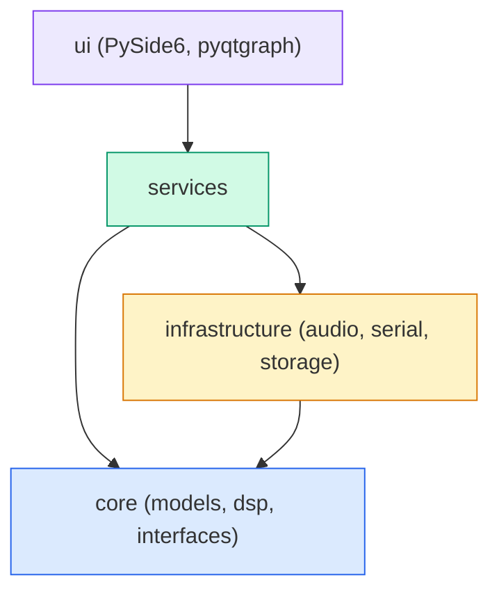
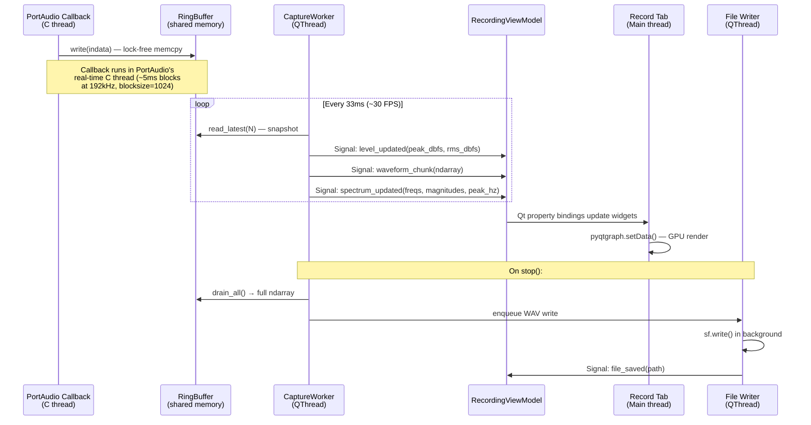
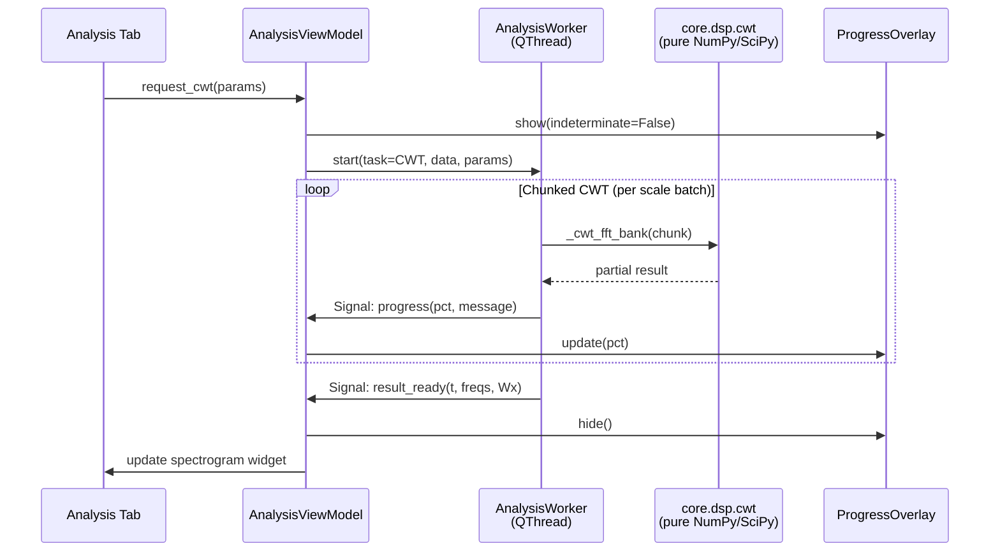

# MedAudioLab v2 — Architectural Design & Implementation Roadmap

## Executive Summary

This document presents the complete architectural redesign of MedAudioLab: a commercial-grade desktop application for recording, processing, and analyzing high-frequency audio and ultrasonic signals (up to 384+ kHz). The redesign replaces the Tkinter-based prototype with a PySide6/pyqtgraph stack, introduces strict layered architecture with dependency inversion, and resolves critical bottlenecks including UI freezes during CWT computation, memory leaks, and tight coupling between DSP and presentation.

> [!IMPORTANT]
> The legacy prototype ([app.py](file:///c:/Users/dmitriy/PythonProjects/med-audio-lab/med_audio_lab/gui/app.py) — 1794 lines in a single file) conflates recording state, DSP orchestration, UI layout, and persistence into one monolithic Tkinter class. This document specifies a clean decomposition into 5 layers with 30+ focused modules.

---

## PART 1: SYSTEM ARCHITECTURE & PROJECT TOPOLOGY

### 1.1 Production Directory Structure

```text
med-audio-lab/
├── run.py                              # Entry point (unchanged)
├── requirements.txt                    # Dependency manifest
├── pyproject.toml                      # Build metadata & tool config
├── medaudiolab.spec                    # PyInstaller spec file
├── resources/
│   ├── wavelet_scales.txt              # CWT scale configuration
│   ├── icons/                          # SVG/PNG app icons
│   └── styles/
│       └── light.qss                   # Qt stylesheet (light theme)
│
├── app/
│   ├── __init__.py                     # Package root, version
│   ├── __main__.py                     # `python -m app` entry
│   ├── constants.py                    # App-wide constants, enums
│   │
│   ├── core/                           # LAYER 1: Pure domain logic (zero dependencies on Qt/IO)
│   │   ├── __init__.py
│   │   ├── dsp/
│   │   │   ├── __init__.py
│   │   │   ├── fft.py                  # FFT, Welch PSD, windowed spectral analysis
│   │   │   ├── stft.py                 # STFT spectrogram engine
│   │   │   ├── cwt.py                  # Memory-bounded Morlet CWT engine
│   │   │   ├── filters.py             # Zero-phase IIR/FIR filter pipeline (SOS)
│   │   │   ├── envelope.py            # Hilbert analytic signal & envelope extraction
│   │   │   ├── impulse_detector.py    # Adaptive threshold pulse detection
│   │   │   ├── metrics.py            # Signal statistics (RMS, peak, THD, spectral moments)
│   │   │   ├── heterodyne.py          # Ultrasonic down-shifting for audible monitoring
│   │   │   └── scales.py              # Wavelet scale loading & gap densification
│   │   │
│   │   ├── models/
│   │   │   ├── __init__.py
│   │   │   ├── audio_buffer.py        # Immutable AudioBuffer value object
│   │   │   ├── recording_session.py   # RecordingSession entity
│   │   │   ├── analysis_result.py     # AnalysisResult data classes
│   │   │   ├── impulse.py             # DetectedImpulse data class
│   │   │   └── device_info.py         # AudioDeviceInfo, SerialPortInfo
│   │   │
│   │   └── interfaces/
│   │       ├── __init__.py
│   │       ├── audio_engine.py        # IAudioEngine protocol (ABC)
│   │       ├── serial_engine.py       # ISerialEngine protocol (ABC)
│   │       ├── storage_repository.py  # IStorageRepository protocol (ABC)
│   │       └── export_service.py      # IExportService protocol (ABC)
│   │
│   ├── infrastructure/                 # LAYER 2: I/O, hardware, persistence
│   │   ├── __init__.py
│   │   ├── audio/
│   │   │   ├── __init__.py
│   │   │   ├── device_manager.py      # AudioDeviceManager (sounddevice enumeration)
│   │   │   ├── capture_engine.py      # CaptureEngine (PortAudio callback → ring buffer)
│   │   │   ├── playback_engine.py     # PlaybackEngine (output stream management)
│   │   │   └── ring_buffer.py         # Lock-free circular ring buffer (NumPy-backed)
│   │   │
│   │   ├── serial/
│   │   │   ├── __init__.py
│   │   │   ├── serial_engine.py       # SerialCaptureEngine (UART/ADC reader)
│   │   │   └── protocol_detector.py   # Binary vs text auto-detection
│   │   │
│   │   └── storage/
│   │       ├── __init__.py
│   │       ├── file_io.py             # WAV/CSV/TXT/BWF readers & writers
│   │       ├── sqlite_repository.py   # SQLite recording & metrics repository
│   │       └── export.py              # CSV/PNG/PDF export service
│   │
│   ├── services/                       # LAYER 3: Application orchestration
│   │   ├── __init__.py
│   │   ├── recording_service.py       # RecordingService (start/pause/stop workflow)
│   │   ├── analysis_service.py        # AnalysisService (async DSP dispatch)
│   │   ├── project_manager.py         # ProjectManager (session lifecycle, file paths)
│   │   └── settings_service.py        # SettingsService (persistent app configuration)
│   │
│   └── ui/                             # LAYER 4: Presentation (PySide6)
│       ├── __init__.py
│       ├── main_window.py             # QMainWindow shell with tab navigation
│       ├── viewmodels/
│       │   ├── __init__.py
│       │   ├── recording_vm.py        # RecordingViewModel (reactive state for Record tab)
│       │   ├── analysis_vm.py         # AnalysisViewModel (reactive state for Analysis tab)
│       │   └── library_vm.py          # LibraryViewModel (recording list, search, load)
│       │
│       ├── widgets/
│       │   ├── __init__.py
│       │   ├── waveform_widget.py     # pyqtgraph real-time waveform display
│       │   ├── spectrum_widget.py     # pyqtgraph live FFT spectrum display
│       │   ├── spectrogram_widget.py  # Matplotlib STFT/CWT scalogram canvas
│       │   ├── level_meter.py         # Peak/RMS level meter with clip indicator
│       │   ├── device_selector.py     # Audio/serial device combo with refresh
│       │   └── progress_overlay.py    # Non-blocking progress dialog for heavy DSP
│       │
│       ├── tabs/
│       │   ├── __init__.py
│       │   ├── record_tab.py          # Recording workflow tab
│       │   ├── analysis_tab.py        # Signal analysis tab
│       │   └── library_tab.py         # Recording database browser tab
│       │
│       └── workers/
│           ├── __init__.py
│           ├── capture_worker.py      # QThread wrapper for audio capture monitoring
│           ├── analysis_worker.py     # QThread wrapper for background DSP
│           └── export_worker.py       # QThread wrapper for background file export
│
├── tests/
│   ├── __init__.py
│   ├── test_core_dsp/
│   │   ├── test_fft.py
│   │   ├── test_cwt.py
│   │   ├── test_filters.py
│   │   ├── test_impulse_detector.py
│   │   └── test_metrics.py
│   ├── test_infrastructure/
│   │   ├── test_ring_buffer.py
│   │   ├── test_file_io.py
│   │   └── test_sqlite_repository.py
│   └── test_services/
│       ├── test_recording_service.py
│       └── test_analysis_service.py
│
└── scripts/
    ├── build_exe.bat
    ├── build_exe.ps1
    └── test_record_tones.py
```

### 1.2 Technology Stack & Dependency Matrix

| Category | Library | Version | Rationale |
|---|---|---|---|
| **UI Framework** | PySide6 | ≥6.6 | Qt 6 bindings — mature, fast event loop, QThread, commercial-friendly LGPL |
| **High-rate plotting** | pyqtgraph | ≥0.13 | GPU-accelerated OpenGL scatter/line plots, 60 FPS on 10M+ points |
| **Publication plots** | matplotlib | ≥3.8 | Vector PDF/SVG export, STFT/CWT colormaps, Matplotlib Qt backend |
| **Numerics** | numpy | ≥1.26 | Vectorized array ops, FFT, ring buffer backing |
| **DSP** | scipy | ≥1.12 | `signal.sosfiltfilt`, `signal.welch`, `signal.hilbert`, `signal.resample_poly` |
| **Audio I/O** | sounddevice | ≥0.5 | PortAudio bindings (WASAPI, DirectSound, ASIO, CoreAudio, ALSA) |
| **Audio files** | soundfile | ≥0.12 | libsndfile wrapper — BWF, 24-bit PCM, FLOAT_32 WAV |
| **Serial I/O** | pyserial | ≥3.5 | UART/COM port access for external ADC streams |
| **Packaging** | PyInstaller | ≥6.0 | Single-file `.exe` freeze with `--onefile --windowed` |
| **Testing** | pytest | ≥8.0 | Unit & integration testing |

#### `requirements.txt`

```text
PySide6>=6.6,<7
pyqtgraph>=0.13
matplotlib>=3.8
numpy>=1.26
scipy>=1.12
sounddevice>=0.5
soundfile>=0.12
pyserial>=3.5
pyinstaller>=6.0
pytest>=8.0
```

### 1.3 Layer Dependency Rules



> [!WARNING]
> **Inversion of Control**: `core` defines abstract interfaces (`IAudioEngine`, `IStorageRepository`). `infrastructure` implements them. `services` depends only on abstractions. `ui` depends on services via ViewModels. No layer may import upward.

---

## PART 2: DATA FLOW & THREADING MODEL

### 2.1 Audio Capture Pipeline



### 2.2 Background Analysis Pipeline (CWT/STFT)



### 2.3 Concurrency Strategy

| Concern | Solution |
|---|---|
| **PortAudio callback (C thread)** | Lock-free ring buffer with atomic head/tail pointers. No Python objects allocated in callback. |
| **GIL contention during FFT** | NumPy/SciPy release the GIL during C-level computation (`np.fft.fft`, `scipy.signal.sosfiltfilt`). QThread workers can run in parallel. |
| **UI responsiveness** | All DSP > 50ms runs in `QThread` subclass. Progress reported via Qt signals (thread-safe cross-thread delivery). |
| **Ring buffer safety** | Single-producer (PortAudio callback), single-consumer (CaptureWorker). No mutex needed — atomic index + memory fence. Python implementation uses `threading.Lock` as conservative fallback with ~0.1μs overhead. |
| **Serial reader thread** | Dedicated `threading.Thread` (daemon) polls COM port, appends to thread-safe deque. CaptureWorker reads snapshots on timer. |
| **File I/O** | WAV writes and CSV exports delegated to `ExportWorker` (QThread) to prevent UI stalls on large files. |

### 2.4 Ring Buffer Design

```
┌─────────────────────────────────────────────────────────┐
│  NumPy ndarray (dtype=float32, shape=(capacity,))       │
│                                                         │
│  write_pos ──┐              ┌── read_pos                │
│              ▼              ▼                            │
│  [ _ _ _ _ [W W W W W W W W] R R R R _ _ _ _ _ _ _ ]   │
│                                                         │
│  capacity = 2^N (power of two for fast modulo via &)    │
│  available = (write_pos - read_pos) & (capacity - 1)    │
└─────────────────────────────────────────────────────────┘
```

- **Capacity**: `2^20` = 1,048,576 samples (~5.5s at 192 kHz). Configurable.
- **Overflow policy**: Oldest data silently overwritten (circular). No allocation.
- **Read modes**: `read_latest(n)` for live display; `drain_all()` for final capture.

---

## PART 3: DETAILED CLASS & API SPECIFICATION

### 3.1 Core Interfaces

```python
# app/core/interfaces/audio_engine.py
from __future__ import annotations
from abc import ABC, abstractmethod
from typing import Protocol, Callable
import numpy as np
from app.core.models.device_info import AudioDeviceInfo

class IAudioCaptureEngine(ABC):
    """Abstract audio capture engine — implemented by infrastructure."""
    
    @abstractmethod
    def list_input_devices(self) -> list[AudioDeviceInfo]: ...
    
    @abstractmethod
    def start(
        self,
        device_index: int | None,
        sample_rate: int,
        channels: int = 1,
        dtype: str = "float32",
        block_size: int = 1024,
    ) -> None: ...
    
    @abstractmethod
    def pause(self) -> None: ...
    
    @abstractmethod
    def resume(self) -> None: ...
    
    @abstractmethod
    def stop(self) -> np.ndarray: ...
    
    @abstractmethod
    def snapshot(self, max_samples: int | None = None) -> np.ndarray: ...
    
    @abstractmethod
    def peak_rms(self) -> tuple[float, float]:
        """Returns (peak_dbfs, rms_dbfs) of current buffer window."""
        ...
    
    @property
    @abstractmethod
    def is_recording(self) -> bool: ...
    
    @property
    @abstractmethod
    def is_paused(self) -> bool: ...
    
    @property
    @abstractmethod
    def sample_rate(self) -> int: ...


class IAudioPlaybackEngine(ABC):
    """Abstract playback engine."""
    
    @abstractmethod
    def list_output_devices(self) -> list[AudioDeviceInfo]: ...
    
    @abstractmethod
    def play(
        self, data: np.ndarray, sample_rate: int, device_index: int | None = None
    ) -> None: ...
    
    @abstractmethod
    def stop(self) -> None: ...
    
    @property
    @abstractmethod
    def is_playing(self) -> bool: ...
```

### 3.2 Ring Buffer

```python
# app/infrastructure/audio/ring_buffer.py
from __future__ import annotations
import threading
import numpy as np

class RingBuffer:
    """Thread-safe circular buffer backed by a pre-allocated NumPy array.
    
    Single-producer (audio callback), single-consumer (UI worker).
    Power-of-two capacity for branchless modulo.
    """
    
    __slots__ = ("_buf", "_capacity", "_mask", "_write_pos", "_read_pos", "_lock")
    
    def __init__(self, capacity: int = 1 << 20, dtype: np.dtype = np.float32) -> None:
        # Round up to next power of two
        self._capacity = 1 << max(1, (capacity - 1).bit_length())
        self._mask = self._capacity - 1
        self._buf = np.zeros(self._capacity, dtype=dtype)
        self._write_pos: int = 0
        self._read_pos: int = 0
        self._lock = threading.Lock()
    
    @property
    def capacity(self) -> int:
        return self._capacity
    
    @property
    def available(self) -> int:
        return (self._write_pos - self._read_pos) & self._mask
    
    def write(self, data: np.ndarray) -> int:
        """Write samples into the buffer. Returns number of samples written.
        Called from audio callback thread."""
        n = data.shape[0]
        if n == 0:
            return 0
        if n >= self._capacity:
            # Only keep the last capacity samples
            data = data[-self._capacity:]
            n = self._capacity
        
        start = self._write_pos & self._mask
        end = start + n
        
        with self._lock:
            if end <= self._capacity:
                self._buf[start:end] = data
            else:
                first = self._capacity - start
                self._buf[start:] = data[:first]
                self._buf[:n - first] = data[first:]
            self._write_pos += n
        return n
    
    def read_latest(self, count: int) -> np.ndarray:
        """Read the most recent `count` samples without consuming them.
        Called from UI worker thread."""
        with self._lock:
            avail = min(count, (self._write_pos - self._read_pos) & self._mask,
                       self._write_pos)
            if avail <= 0:
                return np.zeros(0, dtype=self._buf.dtype)
            start = (self._write_pos - avail) & self._mask
            if start + avail <= self._capacity:
                return self._buf[start:start + avail].copy()
            else:
                first = self._capacity - start
                return np.concatenate([
                    self._buf[start:],
                    self._buf[:avail - first]
                ])
    
    def drain_all(self) -> np.ndarray:
        """Read and consume all available samples. Used on recording stop."""
        with self._lock:
            avail = min(self._write_pos, self._capacity)
            if avail <= 0:
                return np.zeros(0, dtype=self._buf.dtype)
            start = (self._write_pos - avail) & self._mask
            if start + avail <= self._capacity:
                result = self._buf[start:start + avail].copy()
            else:
                first = self._capacity - start
                result = np.concatenate([
                    self._buf[start:],
                    self._buf[:avail - first]
                ])
            self._read_pos = self._write_pos
            return result
    
    def reset(self) -> None:
        """Clear the buffer."""
        with self._lock:
            self._write_pos = 0
            self._read_pos = 0
            self._buf[:] = 0
```

### 3.3 AudioDeviceManager

```python
# app/infrastructure/audio/device_manager.py
from __future__ import annotations
from dataclasses import dataclass
import sounddevice as sd
from app.core.models.device_info import AudioDeviceInfo

class AudioDeviceManager:
    """Enumerates and validates audio hardware via PortAudio."""
    
    STANDARD_RATES = [44100, 48000, 96000, 192000, 384000, 768000]
    
    @staticmethod
    def list_input_devices() -> list[AudioDeviceInfo]:
        devices = []
        for idx, info in enumerate(sd.query_devices()):
            if int(info.get("max_input_channels", 0)) > 0:
                devices.append(AudioDeviceInfo(
                    index=idx,
                    name=str(info["name"]),
                    input_channels=int(info["max_input_channels"]),
                    output_channels=int(info.get("max_output_channels", 0)),
                    default_sample_rate=int(float(info["default_samplerate"])),
                    hostapi=str(sd.query_hostapis(info["hostapi"])["name"]),
                ))
        return devices
    
    @staticmethod
    def list_output_devices() -> list[AudioDeviceInfo]:
        devices = []
        for idx, info in enumerate(sd.query_devices()):
            if int(info.get("max_output_channels", 0)) > 0:
                devices.append(AudioDeviceInfo(
                    index=idx,
                    name=str(info["name"]),
                    input_channels=int(info.get("max_input_channels", 0)),
                    output_channels=int(info["max_output_channels"]),
                    default_sample_rate=int(float(info["default_samplerate"])),
                    hostapi=str(sd.query_hostapis(info["hostapi"])["name"]),
                ))
        return devices
    
    @staticmethod
    def supported_rates(device_index: int) -> list[int]:
        """Probe which standard sample rates the device actually supports."""
        supported = []
        for rate in AudioDeviceManager.STANDARD_RATES:
            try:
                sd.check_input_settings(device=device_index, samplerate=rate)
                supported.append(rate)
            except Exception:
                pass
        return supported
```

### 3.4 SignalProcessor (DSP Facade)

```python
# Conceptual facade — each method delegates to the appropriate core.dsp module
class SignalProcessor:
    """High-level DSP facade used by AnalysisService.
    
    All methods are pure, stateless, and accept/return NumPy arrays.
    Thread-safe by design (no mutable state).
    """
    
    def fft_spectrum(
        self, x: np.ndarray, fs: int, *, 
        window: str = "hann",
        fmin_hz: float = 0.0,
        fmax_hz: float | None = None,
    ) -> tuple[np.ndarray, np.ndarray]:
        """Full-resolution FFT. Returns (frequencies_hz, magnitudes)."""
        ...
    
    def welch_psd(
        self, x: np.ndarray, fs: int, *,
        nperseg: int = 4096,
        window: str = "hann",
    ) -> tuple[np.ndarray, np.ndarray]:
        """Welch Power Spectral Density. Returns (frequencies_hz, psd)."""
        ...
    
    def stft(
        self, x: np.ndarray, fs: int, *,
        nperseg: int = 4096,
        noverlap: int = 3072,
        window: str = "hann",
        fmin_hz: float = 0.0,
        fmax_hz: float = 100_000.0,
    ) -> tuple[np.ndarray, np.ndarray, np.ndarray]:
        """STFT spectrogram. Returns (time, frequencies, magnitude_db)."""
        ...
    
    def cwt_morlet(
        self, x: np.ndarray, fs: int, *,
        fmin_hz: float = 100.0,
        fmax_hz: float = 100_000.0,
        max_seconds: float | None = 4.0,
        memory_budget_mb: float = 800.0,
        progress_callback: Callable[[float, str], None] | None = None,
    ) -> tuple[np.ndarray, np.ndarray, np.ndarray]:
        """Memory-bounded Morlet CWT. Returns (time, frequencies_hz, Wx_complex)."""
        ...
    
    def filter_signal(
        self, x: np.ndarray, fs: int, *,
        filter_type: str,  # "highpass" | "lowpass" | "bandpass" | "bandstop"
        freq_hz: float | tuple[float, float],
        order: int = 4,
        design: str = "butter",
    ) -> np.ndarray:
        """Zero-phase IIR filtering via sosfiltfilt."""
        ...
    
    def detect_impulses(
        self, x: np.ndarray, fs: int, **kwargs
    ) -> list[DetectedImpulse]:
        """Adaptive threshold pulse detection."""
        ...
    
    def hilbert_envelope(self, x: np.ndarray) -> np.ndarray:
        """Analytic signal envelope via Hilbert transform."""
        ...
    
    def compute_metrics(
        self, x: np.ndarray, fs: int
    ) -> SignalMetrics:
        """Full signal statistics: RMS, peak, THD, spectral centroid, etc."""
        ...
    
    def estimate_thd(
        self, x: np.ndarray, fs: int, fundamental_hz: float, n_harmonics: int = 6
    ) -> float:
        """Total Harmonic Distortion as a ratio."""
        ...
```

### 3.5 ContinuousWaveletTransformEngine

```python
# Detailed in PART 4 — key API surface:
class CwtEngine:
    """Memory-bounded, chunked Morlet CWT with frequency-domain FFT convolution."""
    
    def __init__(
        self,
        w0: float = 2.0 * np.pi,
        memory_budget_mb: float = 800.0,
        chunk_scales: int = 8,
    ) -> None: ...
    
    def compute(
        self,
        x: np.ndarray,
        fs: int,
        *,
        fmin_hz: float = 100.0,
        fmax_hz: float = 100_000.0,
        scales: np.ndarray | None = None,
        max_seconds: float | None = None,
        target_fs: int | None = None,
        progress_callback: Callable[[float, str], None] | None = None,
    ) -> CwtResult: ...
    
    def lateral_slice(
        self, result: CwtResult, t0_s: float
    ) -> tuple[np.ndarray, np.ndarray]: ...
    
    def longitudinal_slice(
        self, result: CwtResult, f0_hz: float
    ) -> tuple[np.ndarray, np.ndarray]: ...
    
    def ridge_detection(
        self, result: CwtResult
    ) -> tuple[np.ndarray, np.ndarray]: ...
```

### 3.6 RecordingSessionManager

```python
# app/services/recording_service.py
class RecordingService(QObject):
    """Orchestrates the recording lifecycle.
    
    Signals:
        recording_started(sample_rate: int)
        recording_paused()
        recording_resumed()
        recording_stopped(session: RecordingSession)
        level_updated(peak_dbfs: float, rms_dbfs: float)
        live_data(data: np.ndarray)
        error_occurred(message: str)
    """
    
    recording_started = Signal(int)
    recording_paused = Signal()
    recording_resumed = Signal()
    recording_stopped = Signal(object)  # RecordingSession
    level_updated = Signal(float, float)
    live_data = Signal(object)  # np.ndarray
    error_occurred = Signal(str)
    
    def __init__(
        self,
        audio_engine: IAudioCaptureEngine,
        serial_engine: ISerialEngine,
        storage: IStorageRepository,
        settings: SettingsService,
    ) -> None: ...
    
    def start_audio(self, device_index: int | None, sample_rate: int) -> None: ...
    def start_serial(self, port: str, baudrate: int, analysis_rate: int) -> None: ...
    def pause(self) -> None: ...
    def resume(self) -> None: ...
    def stop_and_save(self, title: str, patient: str, notes: str) -> None: ...
```

---

## PART 4: PRODUCTION-READY CORE DSP IMPLEMENTATIONS

### 4.1 CWT Engine — Memory-Bounded Morlet CWT

```python
"""
app/core/dsp/cwt.py

Memory-bounded Continuous Wavelet Transform using frequency-domain FFT convolution
with Complex Morlet wavelet. Designed for ultrasonic signals up to 384 kHz.

Key design decisions:
- Scales are processed in chunks of `chunk_scales` to bound peak memory
- Signal is zero-padded to next power-of-two for FFT efficiency
- Negative frequencies zeroed (analytic wavelet)
- Scale gap densification ensures sub-bin frequency resolution
- Progress callback enables responsive UI during long computations
"""
from __future__ import annotations

from dataclasses import dataclass, field
from pathlib import Path
from typing import Callable

import numpy as np

try:
    from scipy.signal import resample_poly
except ImportError:
    resample_poly = None


@dataclass(frozen=True)
class CwtResult:
    """Immutable result container for CWT computation."""
    fs: int
    time: np.ndarray
    frequencies_hz: np.ndarray
    coefficients: np.ndarray  # complex64, shape (n_scales, n_time)
    scales: np.ndarray

    @property
    def amplitude(self) -> np.ndarray:
        return np.abs(self.coefficients)

    @property
    def power(self) -> np.ndarray:
        return np.abs(self.coefficients) ** 2

    @property
    def phase(self) -> np.ndarray:
        return np.angle(self.coefficients)


def _next_pow2(n: int) -> int:
    """Next power of two >= n."""
    return 1 if n <= 1 else 1 << (int(n - 1).bit_length())


def _densify_scale_gaps(
    scales: np.ndarray,
    *,
    gap_ratio: float = 1.25,
    max_freq_ratio: float = 1.08,
) -> np.ndarray:
    """Insert intermediate Morlet scales where adjacent central frequencies
    are too far apart (f ∝ 1/scale). Without this, a tone at e.g. 30 kHz
    at fs=192kHz (needing scale ≈ 6.4) might fall between CWT rows."""
    scales = np.asarray(scales, dtype=np.float64)
    if scales.size < 2:
        return scales
    out: list[float] = [float(scales[0])]
    for s0, s1 in zip(scales[:-1], scales[1:]):
        s0, s1 = float(s0), float(s1)
        ratio = s1 / s0
        if ratio > gap_ratio:
            n_insert = int(np.ceil(np.log(ratio) / np.log(max_freq_ratio))) - 1
            if n_insert > 0:
                inserted = np.geomspace(s0, s1, n_insert + 2, dtype=np.float64)[1:-1]
                out.extend(float(x) for x in inserted)
        out.append(s1)
    return np.unique(np.asarray(out, dtype=np.float64))


def load_scales(path: str | Path | None = None) -> np.ndarray:
    """Load CWT scales from a text file, with fallback to geometric default."""
    default = np.geomspace(2.0, 5986.0, 116).astype(np.float64)
    if path is None:
        # Search relative to this module
        cfg = Path(__file__).resolve().parent.parent.parent.parent / "resources" / "wavelet_scales.txt"
    else:
        cfg = Path(path)
    if not cfg.exists():
        return _densify_scale_gaps(default)
    values: list[float] = []
    with cfg.open("r", encoding="utf-8") as f:
        for raw in f:
            line = raw.strip()
            if not line or line.startswith("#"):
                continue
            values.append(float(line.replace(",", ".")))
    scales = np.asarray(values, dtype=np.float64)
    if scales.size == 0:
        return _densify_scale_gaps(default)
    if np.any(~np.isfinite(scales)) or np.any(scales <= 0):
        raise ValueError(f"Invalid scale values in '{cfg}'. All scales must be > 0.")
    return _densify_scale_gaps(scales)


def _resample_to_target(
    x: np.ndarray, fs: int, target_fs: int
) -> tuple[np.ndarray, int]:
    """Resample signal to target sample rate using polyphase filtering."""
    if target_fs <= 0 or fs == target_fs:
        return x, fs
    if resample_poly is not None:
        y = resample_poly(x, int(target_fs), int(fs)).astype(np.float32, copy=False)
        return y, int(target_fs)
    # Fallback: linear interpolation
    n_out = max(1, int(round(x.size * target_fs / fs)))
    t_in = np.arange(x.size, dtype=np.float64) / fs
    t_out = np.arange(n_out, dtype=np.float64) / target_fs
    return np.interp(t_out, t_in, x).astype(np.float32, copy=False), int(target_fs)


class CwtEngine:
    """Memory-bounded Morlet CWT with chunked scale processing.
    
    Architecture:
    1. Signal is peak-normalized and optionally resampled
    2. Zero-padded to N_fft = next_pow2(2*N - 1) for linear convolution via FFT
    3. Morlet wavelets constructed in frequency domain: ψ̂(ω) = √s · exp(-½(sω - ω₀)²)
    4. Scales processed in batches of `chunk_scales` to limit memory to ~O(chunk × N_fft)
    5. Negative frequencies zeroed to enforce analytic wavelet
    
    Memory budget:
    - Peak allocation ≈ chunk_scales × N_fft × 8 bytes (complex64)
    - For N=1M samples, chunk=8: ~64 MB per batch (safe on 8GB systems)
    """
    
    def __init__(
        self,
        w0: float = 2.0 * np.pi,
        memory_budget_mb: float = 800.0,
        chunk_scales: int = 8,
    ) -> None:
        self._w0 = float(w0)
        self._memory_budget_mb = float(memory_budget_mb)
        self._chunk_scales = max(1, int(chunk_scales))
    
    def estimate_memory_mb(
        self, n_samples: int, n_scales: int
    ) -> float:
        """Estimate peak memory usage in MB for given dimensions."""
        n_fft = _next_pow2(2 * n_samples - 1)
        # Output matrix: n_scales × n_samples × 8 bytes (complex64)
        output_mb = n_scales * n_samples * 8 / (1024 * 1024)
        # Working set per chunk: chunk × n_fft × 16 bytes (complex128 intermediate)
        working_mb = self._chunk_scales * n_fft * 16 / (1024 * 1024)
        return output_mb + working_mb
    
    def compute(
        self,
        x: np.ndarray,
        fs: int,
        *,
        fmin_hz: float = 100.0,
        fmax_hz: float = 100_000.0,
        scales: np.ndarray | None = None,
        max_seconds: float | None = None,
        target_fs: int | None = None,
        scale_stride: int = 1,
        progress_callback: Callable[[float, str], None] | None = None,
    ) -> CwtResult:
        """Compute the Continuous Wavelet Transform.
        
        Args:
            x: Input signal (1D float32).
            fs: Sample rate in Hz.
            fmin_hz: Minimum frequency of interest.
            fmax_hz: Maximum frequency of interest.
            scales: Custom scale array. If None, loaded from config file.
            max_seconds: Truncate signal to this duration.
            target_fs: Resample to this rate before CWT.
            scale_stride: Skip every N-th scale (for memory reduction).
            progress_callback: Called with (fraction, message) during computation.
        
        Returns:
            CwtResult with time axis, frequency axis, and complex coefficients.
        
        Raises:
            ValueError: If signal is too short or no scales fall in frequency range.
            MemoryError: If estimated memory exceeds budget.
        """
        # --- Preprocessing ---
        x = np.asarray(x, dtype=np.float32).ravel()
        if x.size < 8:
            raise ValueError("Signal too short for CWT (need >= 8 samples).")
        
        # Peak normalize
        peak = float(np.max(np.abs(x)))
        if peak > 0:
            x = (x / peak).astype(np.float32, copy=False)
        
        # Resample if requested
        if target_fs is not None and target_fs > 0 and fs != target_fs:
            x, fs = _resample_to_target(x, fs, target_fs)
        
        # Truncate
        if max_seconds is not None and max_seconds > 0:
            max_n = int(max_seconds * fs)
            if max_n > 0 and x.size > max_n:
                x = x[:max_n]
        
        # --- Scale selection ---
        if scales is None:
            scales = load_scales()
        scales = np.asarray(scales, dtype=np.float64)
        
        stride = max(1, int(scale_stride))
        if stride > 1:
            scales = scales[::stride]
        
        # Convert scales to center frequencies: f = w0 * fs / (2π * s)
        freqs_hz = self._w0 * fs / (2.0 * np.pi * scales)
        
        # Filter to requested frequency band
        band = (freqs_hz >= float(fmin_hz)) & (freqs_hz <= float(fmax_hz))
        if not np.any(band):
            raise ValueError(
                f"No scales in frequency range {fmin_hz:.1f}–{fmax_hz:.1f} Hz. "
                f"Available: {freqs_hz.min():.1f}–{freqs_hz.max():.1f} Hz."
            )
        scales = scales[band]
        freqs_hz = freqs_hz[band]
        
        # --- Memory budget check ---
        mem_mb = self.estimate_memory_mb(x.size, scales.size)
        if mem_mb > self._memory_budget_mb:
            raise MemoryError(
                f"CWT would require ~{mem_mb:.0f} MB (budget: {self._memory_budget_mb:.0f} MB). "
                f"Reduce signal duration, increase scale_stride, or narrow frequency range."
            )
        
        # --- FFT of signal ---
        n = x.size
        n_fft = _next_pow2(2 * n - 1)
        X = np.fft.fft(x.astype(np.float32, copy=False), n=n_fft)
        f_fft = np.fft.fftfreq(n_fft, d=1.0 / fs)
        
        # --- Chunked wavelet convolution ---
        omega_d = 2.0 * np.pi * f_fft / float(fs)
        neg_mask = f_fft < 0
        Wx = np.empty((scales.size, n), dtype=np.complex64)
        
        total_chunks = (scales.size + self._chunk_scales - 1) // self._chunk_scales
        
        for chunk_idx, c0 in enumerate(range(0, scales.size, self._chunk_scales)):
            c1 = min(c0 + self._chunk_scales, scales.size)
            sc = scales[c0:c1]
            s_col = sc[:, np.newaxis]  # (chunk, 1)
            
            # Morlet wavelet in frequency domain:
            # ψ̂(ω) = √s · exp(-½(s·ω - ω₀)²)
            psi_hat = np.exp(
                -0.5 * ((s_col * omega_d - self._w0) ** 2),
                dtype=np.float64,
            )
            np.multiply(psi_hat, np.sqrt(s_col), out=psi_hat)
            
            # Zero negative frequencies (analytic wavelet)
            psi_hat[:, neg_mask] = 0.0
            
            # Convolution in frequency domain: W(s,τ) = IFFT[X(ω) · ψ̂*(s,ω)]
            conv = np.fft.ifft(X * np.conj(psi_hat), axis=1)
            Wx[c0:c1, :] = conv[:, :n]
            
            # Report progress
            if progress_callback is not None:
                frac = (chunk_idx + 1) / total_chunks
                progress_callback(
                    frac,
                    f"CWT: scales {c0+1}–{c1} of {scales.size} "
                    f"({frac*100:.0f}%)",
                )
        
        t = np.arange(n, dtype=np.float64) / fs
        
        return CwtResult(
            fs=fs,
            time=t,
            frequencies_hz=freqs_hz,
            coefficients=Wx,
            scales=scales,
        )
    
    def lateral_slice(
        self, result: CwtResult, t0_s: float
    ) -> tuple[np.ndarray, np.ndarray]:
        """Frequency spectrum at a specific time instant.
        
        Returns:
            (frequencies_hz, amplitude) arrays.
        """
        t_idx = int(np.argmin(np.abs(result.time - t0_s)))
        amp = np.abs(result.coefficients[:, t_idx])
        return result.frequencies_hz.copy(), amp.astype(np.float64)
    
    def longitudinal_slice(
        self, result: CwtResult, f0_hz: float
    ) -> tuple[np.ndarray, np.ndarray]:
        """Temporal cross-section Re(W_x) at a specific frequency.
        
        Returns:
            (time_relative_s, normalized_real_part) arrays.
        """
        f_idx = int(np.argmin(np.abs(result.frequencies_hz - f0_hz)))
        wx_row = result.coefficients[f_idx, :]
        re = np.real(wx_row.astype(np.complex128))
        denom = float(np.max(np.abs(re)))
        if denom > 0:
            re = re / denom
        # Center on peak
        t0 = float(result.time[int(np.argmax(np.abs(re)))])
        t_rel = result.time - t0
        return t_rel.astype(np.float64), re.astype(np.float64)
    
    def ridge_detection(
        self, result: CwtResult
    ) -> tuple[np.ndarray, np.ndarray]:
        """Extract the ridge line (dominant frequency vs time).
        
        Returns:
            (time, ridge_frequencies_hz) arrays.
        """
        amp = np.abs(result.coefficients)
        ridge_idx = np.argmax(amp, axis=0)
        return result.time.copy(), result.frequencies_hz[ridge_idx].copy()
```

### 4.2 Filter Pipeline — Zero-Phase IIR Filtering

```python
"""
app/core/dsp/filters.py

Zero-phase digital filtering using second-order sections (SOS).
Supports Butterworth, Chebyshev Type I, and Chebyshev Type II designs.

Design rationale:
- sosfiltfilt provides zero phase distortion (critical for impulse timing)
- SOS representation avoids numerical instability of transfer function form
- Automatic Nyquist guard prevents invalid filter specs
"""
from __future__ import annotations

from dataclasses import dataclass
from enum import Enum
from typing import Literal

import numpy as np
from scipy.signal import sosfiltfilt, butter, cheby1, cheby2


class FilterType(Enum):
    LOWPASS = "lowpass"
    HIGHPASS = "highpass"
    BANDPASS = "bandpass"
    BANDSTOP = "bandstop"


class FilterDesign(Enum):
    BUTTERWORTH = "butter"
    CHEBYSHEV_I = "cheby1"
    CHEBYSHEV_II = "cheby2"


@dataclass(frozen=True)
class FilterSpec:
    """Immutable filter specification."""
    filter_type: FilterType
    freq_hz: float | tuple[float, float]  # scalar for LP/HP, tuple for BP/BS
    order: int = 4
    design: FilterDesign = FilterDesign.BUTTERWORTH
    ripple_db: float = 0.5  # passband ripple (Cheby I) or stopband atten (Cheby II)


class FilterPipeline:
    """Configurable, zero-phase IIR filter with automatic SOS calculation.
    
    Usage:
        pipeline = FilterPipeline()
        filtered = pipeline.apply(
            signal, fs=192000,
            spec=FilterSpec(FilterType.BANDPASS, (20000, 80000), order=6)
        )
    """
    
    @staticmethod
    def _normalize_frequency(
        freq_hz: float | tuple[float, float],
        fs: int,
        filter_type: FilterType,
    ) -> float | tuple[float, float]:
        """Normalize frequency to [0, 1) relative to Nyquist, with safety margin."""
        nyquist = fs / 2.0
        margin = 0.98  # Stay 2% below Nyquist to avoid instability
        
        if isinstance(freq_hz, tuple):
            lo = min(float(freq_hz[0]) / nyquist, margin)
            hi = min(float(freq_hz[1]) / nyquist, margin)
            if lo <= 0:
                lo = 1e-6
            if hi <= lo:
                raise ValueError(
                    f"Upper cutoff ({freq_hz[1]} Hz) must exceed lower "
                    f"cutoff ({freq_hz[0]} Hz)."
                )
            return (lo, hi)
        else:
            wn = min(float(freq_hz) / nyquist, margin)
            if wn <= 0:
                raise ValueError(f"Cutoff frequency must be > 0 Hz (got {freq_hz}).")
            return wn
    
    @staticmethod
    def design_sos(spec: FilterSpec, fs: int) -> np.ndarray:
        """Compute second-order sections for the given filter specification.
        
        Returns:
            SOS array of shape (n_sections, 6).
        """
        wn = FilterPipeline._normalize_frequency(
            spec.freq_hz, fs, spec.filter_type
        )
        btype = spec.filter_type.value
        
        if spec.design == FilterDesign.BUTTERWORTH:
            sos = butter(spec.order, wn, btype=btype, output="sos")
        elif spec.design == FilterDesign.CHEBYSHEV_I:
            sos = cheby1(spec.order, spec.ripple_db, wn, btype=btype, output="sos")
        elif spec.design == FilterDesign.CHEBYSHEV_II:
            sos = cheby2(spec.order, spec.ripple_db, wn, btype=btype, output="sos")
        else:
            raise ValueError(f"Unknown filter design: {spec.design}")
        
        return sos
    
    def apply(
        self,
        x: np.ndarray,
        fs: int,
        spec: FilterSpec,
    ) -> np.ndarray:
        """Apply zero-phase filtering to the signal.
        
        Args:
            x: Input signal (1D float32/float64).
            fs: Sample rate in Hz.
            spec: Filter specification.
        
        Returns:
            Filtered signal with same length and dtype as input.
        """
        x = np.asarray(x, dtype=np.float64).ravel()
        if x.size < 3 * spec.order:
            raise ValueError(
                f"Signal too short ({x.size} samples) for filter order {spec.order}. "
                f"Need at least {3 * spec.order} samples."
            )
        
        sos = self.design_sos(spec, fs)
        y = sosfiltfilt(sos, x).astype(x.dtype, copy=False)
        return y
    
    def apply_chain(
        self,
        x: np.ndarray,
        fs: int,
        specs: list[FilterSpec],
    ) -> np.ndarray:
        """Apply a chain of filters sequentially.
        
        Args:
            x: Input signal.
            fs: Sample rate.
            specs: List of filter specs to apply in order.
        
        Returns:
            Signal filtered through all stages.
        """
        result = np.asarray(x, dtype=np.float64).ravel()
        for spec in specs:
            result = self.apply(result, fs, spec)
        return result
    
    def frequency_response(
        self,
        spec: FilterSpec,
        fs: int,
        n_points: int = 4096,
    ) -> tuple[np.ndarray, np.ndarray]:
        """Compute the filter's frequency response magnitude.
        
        Returns:
            (frequencies_hz, magnitude_db) arrays.
        """
        from scipy.signal import sosfreqz
        sos = self.design_sos(spec, fs)
        w, h = sosfreqz(sos, worN=n_points, fs=fs)
        mag_db = 20.0 * np.log10(np.maximum(np.abs(h), 1e-12))
        return np.asarray(w, dtype=np.float64), mag_db.astype(np.float64)
```

### 4.3 Impulse Detector — Adaptive Threshold Pulse Detection

```python
"""
app/core/dsp/impulse_detector.py

Robust ultrasonic pulse/impulse train detection using adaptive thresholding.
Noise floor estimated via Median Absolute Deviation (MAD) of the signal envelope.

Design rationale:
- MAD-based noise floor is robust to outliers (unlike mean/std)
- Envelope smoothing reduces false triggers from oscillation zero-crossings
- Merge gap prevents a single pulse from splitting into multiple detections
- Per-impulse FFT extracts dominant frequency of each detected burst
"""
from __future__ import annotations

import math
from dataclasses import dataclass, field
from typing import Callable

import numpy as np


@dataclass(frozen=True)
class DetectedImpulse:
    """Immutable data class for a single detected pulse."""
    index: int
    start_sample: int
    end_sample: int
    start_s: float
    end_s: float
    duration_ms: float
    peak_time_s: float
    peak_amplitude: float
    rms: float
    dominant_freq_hz: float  # NaN if undetermined
    interval_ms: float  # NaN for the first impulse
    threshold_used: float


@dataclass
class ImpulseDetectorConfig:
    """Configuration for impulse detection."""
    threshold_db: float = -35.0
    min_duration_ms: float = 0.4
    merge_gap_ms: float = 1.5
    pre_pad_ms: float = 0.15
    post_pad_ms: float = 0.35
    envelope_ms: float = 0.35
    fmin_hz: float = 5000.0
    fmax_hz: float | None = None
    noise_factor: float = 6.0


class ImpulseDetector:
    """Adaptive threshold impulse detector for ultrasonic burst signals.
    
    Algorithm:
    1. Remove DC offset from signal
    2. Compute smoothed envelope via moving average of |x|
    3. Normalize envelope to [0, 1]
    4. Calculate adaptive threshold = median + noise_factor × 1.4826 × MAD
    5. Threshold is max(fixed_threshold, adaptive_threshold), capped at 0.85
    6. Detect active regions where envelope > threshold
    7. Merge adjacent regions closer than merge_gap_ms
    8. Extract metrics (peak, RMS, dominant frequency) for each impulse
    
    The 1.4826 factor converts MAD to an estimate of standard deviation
    for normally distributed data.
    """
    
    def __init__(self, config: ImpulseDetectorConfig | None = None) -> None:
        self._config = config or ImpulseDetectorConfig()
    
    @property
    def config(self) -> ImpulseDetectorConfig:
        return self._config
    
    @config.setter
    def config(self, value: ImpulseDetectorConfig) -> None:
        self._config = value
    
    @staticmethod
    def _remove_dc(x: np.ndarray) -> np.ndarray:
        """Remove DC offset (mean subtraction)."""
        x = x.copy()
        if x.size > 0:
            x -= float(np.mean(x))
        return x
    
    @staticmethod
    def _compute_envelope(
        x: np.ndarray, fs: int, envelope_ms: float
    ) -> np.ndarray:
        """Compute smoothed amplitude envelope."""
        abs_x = np.abs(x).astype(np.float32)
        win = max(1, int(fs * envelope_ms / 1000.0))
        if win > 1:
            kernel = np.ones(win, dtype=np.float32) / win
            return np.convolve(abs_x, kernel, mode="same").astype(np.float32)
        return abs_x
    
    @staticmethod
    def _estimate_dominant_frequency(
        segment: np.ndarray, fs: int, fmin_hz: float, fmax_hz: float
    ) -> float:
        """FFT-based dominant frequency estimation for a short segment."""
        if segment.size < 32:
            return math.nan
        
        window = np.hanning(segment.size).astype(np.float32)
        windowed = segment * window
        spectrum = np.abs(np.fft.rfft(windowed))
        freqs = np.fft.rfftfreq(segment.size, d=1.0 / fs)
        
        band = (freqs >= fmin_hz) & (freqs <= fmax_hz)
        if not np.any(band):
            return math.nan
        
        band_spectrum = spectrum[band]
        band_freqs = freqs[band]
        
        peak_idx = int(np.argmax(band_spectrum))
        peak_freq = float(band_freqs[peak_idx])
        
        # Parabolic interpolation for sub-bin precision
        if 0 < peak_idx < band_spectrum.size - 1:
            alpha = float(band_spectrum[peak_idx - 1])
            beta = float(band_spectrum[peak_idx])
            gamma = float(band_spectrum[peak_idx + 1])
            denom = alpha - 2 * beta + gamma
            if abs(denom) > 1e-12:
                delta = 0.5 * (alpha - gamma) / denom
                df = float(band_freqs[1] - band_freqs[0]) if band_freqs.size > 1 else 0.0
                peak_freq += delta * df
        
        return peak_freq if peak_freq > 0 else math.nan
    
    def detect(
        self,
        x: np.ndarray,
        fs: int,
        config: ImpulseDetectorConfig | None = None,
    ) -> list[DetectedImpulse]:
        """Detect impulse bursts in the signal.
        
        Args:
            x: Input signal (1D float).
            fs: Sample rate in Hz.
            config: Override configuration. If None, uses instance config.
        
        Returns:
            List of DetectedImpulse objects, sorted by time.
        """
        cfg = config or self._config
        
        # Preprocessing
        x = np.asarray(x, dtype=np.float32).ravel()
        x = self._remove_dc(x)
        fs = max(1, int(fs))
        
        if x.size < 8:
            return []
        
        # Compute envelope
        env = self._compute_envelope(x, fs, cfg.envelope_ms)
        peak_env = float(np.max(env))
        if peak_env <= 1e-12:
            return []
        env_norm = env / peak_env
        
        # Adaptive threshold via MAD
        fixed_threshold = 10.0 ** (float(cfg.threshold_db) / 20.0)
        median_val = float(np.median(env_norm))
        mad_val = float(np.median(np.abs(env_norm - median_val)))
        adaptive_threshold = median_val + float(cfg.noise_factor) * 1.4826 * mad_val
        threshold = min(0.85, max(fixed_threshold, adaptive_threshold))
        
        # Find active regions
        active = env_norm >= threshold
        if not np.any(active):
            return []
        
        # Detect edges
        padded = np.concatenate(([0], active.astype(np.int8), [0]))
        edges = np.diff(padded)
        starts = np.flatnonzero(edges == 1)
        ends = np.flatnonzero(edges == -1)
        
        # Merge close regions
        merge_gap = max(0, int(fs * float(cfg.merge_gap_ms) / 1000.0))
        merged: list[tuple[int, int]] = []
        for start, end in zip(starts, ends):
            si, ei = int(start), int(end)
            if merged and si - merged[-1][1] <= merge_gap:
                merged[-1] = (merged[-1][0], ei)
            else:
                merged.append((si, ei))
        
        # Extract impulses
        min_len = max(1, int(fs * float(cfg.min_duration_ms) / 1000.0))
        pre = max(0, int(fs * float(cfg.pre_pad_ms) / 1000.0))
        post = max(0, int(fs * float(cfg.post_pad_ms) / 1000.0))
        fmax = min(float(cfg.fmax_hz) if cfg.fmax_hz else fs / 2.0, fs / 2.0)
        
        impulses: list[DetectedImpulse] = []
        last_peak_s: float | None = None
        
        for raw_start, raw_end in merged:
            if raw_end - raw_start < min_len:
                continue
            
            start_i = max(0, raw_start - pre)
            end_i = min(x.size, raw_end + post)
            if end_i <= start_i:
                continue
            
            segment = x[start_i:end_i]
            peak_rel = int(np.argmax(np.abs(segment)))
            peak_i = start_i + peak_rel
            rms = float(np.sqrt(np.mean(np.square(segment))))
            
            dom_hz = self._estimate_dominant_frequency(
                segment, fs, cfg.fmin_hz, fmax
            )
            
            peak_s = peak_i / fs
            interval = math.nan if last_peak_s is None else (peak_s - last_peak_s) * 1000.0
            last_peak_s = peak_s
            
            impulses.append(DetectedImpulse(
                index=len(impulses) + 1,
                start_sample=start_i,
                end_sample=end_i,
                start_s=start_i / fs,
                end_s=end_i / fs,
                duration_ms=(end_i - start_i) / fs * 1000.0,
                peak_time_s=peak_s,
                peak_amplitude=float(np.max(np.abs(segment))),
                rms=rms,
                dominant_freq_hz=dom_hz,
                interval_ms=interval,
                threshold_used=threshold,
            ))
        
        return impulses
```

---

## PART 5: PYINSTALLER PACKAGING & COMMERCIAL FREEZE SPECIFICATION

### 5.1 PyInstaller `.spec` File

```python
# medaudiolab.spec
# -*- mode: python ; coding: utf-8 -*-
"""
PyInstaller spec for MedAudioLab v2.
Build command:
    pyinstaller medaudiolab.spec --noconfirm --clean
"""
import sys
from pathlib import Path
from PyInstaller.utils.hooks import collect_submodules, collect_data_files

block_cipher = None
ROOT = Path(SPECPATH)

# Hidden imports for dynamic imports that PyInstaller can't detect
hidden_imports = [
    # PySide6
    *collect_submodules('PySide6'),
    # scipy submodules used dynamically
    'scipy.signal',
    'scipy.fft',
    'scipy.io',
    'scipy.io.wavfile',
    # sounddevice / PortAudio
    'sounddevice',
    '_sounddevice_data',
    # pyserial
    'serial.tools.list_ports',
    'serial.tools.list_ports_windows',
    'serial.tools.list_ports_common',
    # pyqtgraph
    *collect_submodules('pyqtgraph'),
    # numpy internals
    'numpy.core._methods',
    'numpy.lib.format',
]

# Data files to bundle
datas = [
    # Wavelet scales configuration
    (str(ROOT / 'resources' / 'wavelet_scales.txt'), 'resources'),
    # Qt stylesheet
    (str(ROOT / 'resources' / 'styles'), 'resources/styles'),
    # App icons
    (str(ROOT / 'resources' / 'icons'), 'resources/icons'),
    # sounddevice PortAudio DLLs
    *collect_data_files('sounddevice'),
    *collect_data_files('_sounddevice_data'),
    # soundfile libsndfile DLLs
    *collect_data_files('soundfile'),
]

a = Analysis(
    [str(ROOT / 'run.py')],
    pathex=[str(ROOT)],
    binaries=[],
    datas=datas,
    hiddenimports=hidden_imports,
    hookspath=[],
    hooksconfig={},
    runtime_hooks=[],
    excludes=[
        'tkinter', '_tkinter',  # No longer needed (PySide6 replaces Tkinter)
        'test', 'unittest',
        'IPython', 'jupyter',
    ],
    cipher=block_cipher,
    noarchive=False,
)

pyz = PYZ(a.pure, a.zipped_data, cipher=block_cipher)

exe = EXE(
    pyz,
    a.scripts,
    a.binaries,
    a.zipfiles,
    a.datas,
    [],
    name='MedAudioLab',
    debug=False,
    bootloader_ignore_signals=False,
    strip=False,
    upx=True,
    upx_exclude=[],
    runtime_tmpdir=None,
    console=False,  # Windowed application
    disable_windowed_traceback=False,
    argv_emulation=False,
    target_arch=None,
    codesign_identity=None,
    entitlements_file=None,
    icon=str(ROOT / 'resources' / 'icons' / 'app_icon.ico'),
)
```

### 5.2 Runtime Resource Locator

```python
# app/resource_path.py
"""
Runtime resource locator supporting both development mode and frozen PyInstaller bundles.

In development: resources are at project_root/resources/
In frozen mode: resources are at sys._MEIPASS/resources/
"""
from __future__ import annotations

import sys
from pathlib import Path


def _get_base_path() -> Path:
    """Get the base path for resource resolution."""
    if getattr(sys, 'frozen', False) and hasattr(sys, '_MEIPASS'):
        # Running as PyInstaller bundle
        return Path(sys._MEIPASS)
    else:
        # Running in development
        return Path(__file__).resolve().parent.parent


def get_resource_path(relative_path: str) -> Path:
    """Resolve a resource path that works in both dev and frozen modes.
    
    Args:
        relative_path: Path relative to the resources/ directory.
                       Example: "wavelet_scales.txt" or "styles/light.qss"
    
    Returns:
        Absolute Path to the resource file.
    
    Raises:
        FileNotFoundError: If the resource doesn't exist.
    """
    base = _get_base_path()
    full_path = base / "resources" / relative_path
    if not full_path.exists():
        raise FileNotFoundError(
            f"Resource not found: {full_path}\n"
            f"Base path: {base}\n"
            f"Frozen: {getattr(sys, 'frozen', False)}"
        )
    return full_path


def get_resource_dir() -> Path:
    """Get the resources directory root."""
    return _get_base_path() / "resources"


def is_frozen() -> bool:
    """Check if running as a PyInstaller bundle."""
    return getattr(sys, 'frozen', False) and hasattr(sys, '_MEIPASS')
```

### 5.3 Platform Compatibility Guidelines

| Concern | Windows 10/11 x64 | macOS | Linux |
|---|---|---|---|
| **Audio Backend** | WASAPI (default), DirectSound, ASIO (if DLL present) | CoreAudio | ALSA, PulseAudio |
| **PortAudio DLL** | Bundled via `sounddevice` data files | Bundled `.dylib` | System `libportaudio.so` |
| **libsndfile** | Bundled via `soundfile` data files | Bundled `.dylib` | System `libsndfile.so` |
| **Qt Platform Plugin** | `platforms/qwindows.dll` (auto-bundled by PyInstaller) | `platforms/libqcocoa.dylib` | `platforms/libqxcb.so` |
| **High DPI** | `QApplication.setHighDpiScaleFactorRoundingPolicy` | Automatic Retina support | `QT_AUTO_SCREEN_SCALE_FACTOR=1` |
| **COM/Serial** | `COMx` ports via `pyserial` | `/dev/tty.*` | `/dev/ttyUSB*`, `/dev/ttyACM*` |
| **ASIO Support** | Requires separate ASIO SDK DLL (not redistributable). User must install ASIO4ALL or vendor driver. | N/A | N/A |

> [!TIP]
> **WASAPI Exclusive Mode**: For lowest-latency recording at 192+ kHz on Windows, configure `sounddevice` with `extra_settings=sd.WasapiSettings(exclusive=True)`. This bypasses the Windows audio mixer but locks the device.

---

## PART 6: STEP-BY-STEP PROMPT SCRIPT FOR AI CODE GENERATION

The following is an exhaustive, sequential list of prompts for an AI coding model to produce the complete application codebase file by file. Each prompt is a self-contained unit with exact file paths, data signatures, and zero-placeholder policy.

---

### PHASE 1: Scaffolding & Data Contracts (Prompts 1–8)

---

**Prompt 1 — Project Configuration & Entry Point**

> Create the following files for a PySide6 desktop application called MedAudioLab v2:
>
> **File: `pyproject.toml`** — Project metadata with `[project]` table: name="medaudiolab", version="2.0.0", requires-python=">=3.11", dependencies list matching the requirements below.
>
> **File: `requirements.txt`** — Exact content:
> ```
> PySide6>=6.6,<7
> pyqtgraph>=0.13
> matplotlib>=3.8
> numpy>=1.26
> scipy>=1.12
> sounddevice>=0.5
> soundfile>=0.12
> pyserial>=3.5
> ```
>
> **File: `run.py`** — Entry point that imports and calls `app.ui.main_window.main()`. Handle `KeyboardInterrupt` gracefully.
>
> **File: `app/__init__.py`** — Package root with `__version__ = "2.0.0"`.
>
> **File: `app/__main__.py`** — Allows `python -m app` execution, delegates to `run.py` logic.
>
> **File: `app/constants.py`** — Define enums: `SampleRate` (44100, 48000, 96000, 192000, 384000, 768000), `BitDepth` (PCM_16, PCM_24, FLOAT_32), `FilterType` (LOWPASS, HIGHPASS, BANDPASS, BANDSTOP), `FilterDesign` (BUTTERWORTH, CHEBYSHEV_I, CHEBYSHEV_II). Define constants: `APP_NAME = "MedAudioLab"`, `DEFAULT_BLOCK_SIZE = 1024`, `RING_BUFFER_CAPACITY = 1 << 20`, `MAX_CWT_MEMORY_MB = 800.0`, `LIVE_UPDATE_INTERVAL_MS = 33`.
>
> **File: `app/resource_path.py`** — Complete runtime resource locator with `get_resource_path(relative: str) -> Path`, `is_frozen() -> bool` supporting both development and PyInstaller `sys._MEIPASS` frozen mode. No `# TODO` placeholders.
>
> All files must be fully type-annotated, PEP 8 compliant, and contain complete implementations.

---

**Prompt 2 — Core Data Models**

> Create the data model layer for MedAudioLab v2. All classes must be frozen dataclasses or NamedTuples with full type annotations. No mutable state.
>
> **File: `app/core/__init__.py`** — Empty package init.
>
> **File: `app/core/models/__init__.py`** — Re-export all model classes.
>
> **File: `app/core/models/device_info.py`** — Define `AudioDeviceInfo` (frozen dataclass): `index: int`, `name: str`, `input_channels: int`, `output_channels: int`, `default_sample_rate: int`, `hostapi: str`. Property `label -> str` returning formatted display string. Define `SerialPortInfo` (frozen dataclass): `device: str`, `description: str`. Property `label -> str`.
>
> **File: `app/core/models/audio_buffer.py`** — Define `AudioBuffer` (frozen dataclass): `data: np.ndarray` (float32), `sample_rate: int`, `channels: int = 1`. Properties: `duration_s -> float`, `n_samples -> int`, `peak -> float`, `rms -> float`, `rms_dbfs -> float`, `peak_dbfs -> float`. Method `to_mono() -> AudioBuffer`, `normalize(target_peak: float = 0.95) -> AudioBuffer`, `trim(start_s: float, end_s: float) -> AudioBuffer`.
>
> **File: `app/core/models/recording_session.py`** — Define `RecordingSession` (dataclass): `id: int | None`, `created_at: str`, `title: str`, `patient: str`, `notes: str`, `sample_rate: int`, `duration_s: float`, `file_path: str`, `source: str` ("microphone" | "serial").
>
> **File: `app/core/models/analysis_result.py`** — Define `SignalMetrics` (frozen dataclass) with fields: duration_s, sample_rate, n_samples, rms, peak, rms_dbfs, peak_dbfs, zero_crossing_rate, dominant_freq_hz, spectral_centroid_hz, spectral_bandwidth_hz, spectral_rolloff_hz, thd. Define `CwtResult` (frozen dataclass): fs, time, frequencies_hz, coefficients, scales (with properties amplitude, power, phase). Define `StftResult` (frozen dataclass): time, frequencies_hz, magnitude_db.
>
> **File: `app/core/models/impulse.py`** — Define `DetectedImpulse` (frozen dataclass): index, start_sample, end_sample, start_s, end_s, duration_ms, peak_time_s, peak_amplitude, rms, dominant_freq_hz, interval_ms, threshold_used. Define `ImpulseDetectorConfig` (dataclass, mutable): threshold_db, min_duration_ms, merge_gap_ms, pre_pad_ms, post_pad_ms, envelope_ms, fmin_hz, fmax_hz, noise_factor — all with defaults from the legacy code.
>
> Produce complete, production-grade code for every file. No placeholders.

---

**Prompt 3 — Core Abstract Interfaces**

> Create the abstract interface layer that defines contracts between the core domain and infrastructure. Use Python `abc.ABC` with `@abstractmethod`.
>
> **File: `app/core/interfaces/__init__.py`** — Re-export all interfaces.
>
> **File: `app/core/interfaces/audio_engine.py`** — Define `IAudioCaptureEngine(ABC)` with methods: `list_input_devices() -> list[AudioDeviceInfo]`, `start(device_index, sample_rate, channels, dtype, block_size)`, `pause()`, `resume()`, `stop() -> np.ndarray`, `snapshot(max_samples) -> np.ndarray`, `peak_rms() -> tuple[float, float]`. Properties: `is_recording: bool`, `is_paused: bool`, `sample_rate: int`. Define `IAudioPlaybackEngine(ABC)` with: `list_output_devices() -> list[AudioDeviceInfo]`, `play(data, sample_rate, device_index)`, `stop()`. Property: `is_playing: bool`.
>
> **File: `app/core/interfaces/serial_engine.py`** — Define `ISerialEngine(ABC)` with: `list_ports() -> list[SerialPortInfo]`, `start(port, baudrate)`, `pause()`, `resume()`, `stop() -> np.ndarray`, `snapshot(max_samples) -> np.ndarray`. Properties: `is_recording: bool`, `is_paused: bool`, `actual_sample_rate: int`, `level: float`.
>
> **File: `app/core/interfaces/storage_repository.py`** — Define `IStorageRepository(ABC)` with: `ensure_schema()`, `add_recording(session: RecordingSession) -> int`, `get_recording(id: int) -> RecordingSession | None`, `list_recordings() -> list[RecordingSession]`, `save_metrics(recording_id: int, metrics: dict[str, str])`, `get_metrics(recording_id: int) -> dict[str, str]`, `get_setting(key: str, default: str) -> str`, `set_setting(key: str, value: str)`.
>
> **File: `app/core/interfaces/export_service.py`** — Define `IExportService(ABC)` with: `save_wav(data, sample_rate, path, subtype)`, `save_csv(data, sample_rate, path)`, `export_plot_png(figure, path, dpi)`, `export_plot_pdf(figure, path)`, `export_report_csv(session, metrics, path)`.
>
> All methods must have complete type annotations including return types. Use `from __future__ import annotations` everywhere.

---

**Prompt 4 — Core DSP: FFT, Welch PSD, and STFT**

> Create the Fourier analysis modules for MedAudioLab v2. Pure NumPy/SciPy math, zero UI dependencies, 100% unit-testable.
>
> **File: `app/core/dsp/__init__.py`** — Empty init.
>
> **File: `app/core/dsp/fft.py`** — Implement:
> - `fft_spectrum(x: np.ndarray, fs: int, *, window: str = "hann", fmin_hz: float = 0.0, fmax_hz: float | None = None) -> tuple[np.ndarray, np.ndarray]` — Full-resolution single-sided FFT spectrum. Apply selected window function (support: hann, hamming, blackman-harris, flat-top via `scipy.signal.get_window`). Return `(frequencies_hz, magnitudes_normalized)`. Normalize by N (number of samples). Filter to [fmin_hz, fmax_hz].
> - `dominant_peak(freqs: np.ndarray, magnitudes: np.ndarray, *, fmin_hz: float = 0.0) -> tuple[float, float]` — Find dominant peak frequency with parabolic interpolation for sub-bin precision. Return `(peak_frequency_hz, peak_magnitude)`.
> - `estimate_thd(x: np.ndarray, fs: int, fundamental_hz: float, n_harmonics: int = 6) -> float` — Total Harmonic Distortion as a ratio. Find fundamental and harmonics in FFT, compute sqrt(sum(H_k²)) / H_1.
>
> **File: `app/core/dsp/stft.py`** — Implement:
> - `compute_stft(x: np.ndarray, fs: int, *, nperseg: int = 4096, noverlap: int = 3072, window: str = "hann", fmin_hz: float = 0.0, fmax_hz: float = 100_000.0, db: bool = True) -> StftResult` — STFT spectrogram using stride tricks (no scipy.signal.stft to avoid extra dependencies). Use `np.fft.rfft` on windowed frames. Return StftResult with time, frequencies_hz, magnitude_db arrays. Handle signals shorter than nperseg by zero-padding. Clamp dB floor to -120 dB.
> - `welch_psd(x: np.ndarray, fs: int, *, nperseg: int = 4096, window: str = "hann") -> tuple[np.ndarray, np.ndarray]` — Wrapper around `scipy.signal.welch`. Return (frequencies_hz, psd).
>
> All functions must handle edge cases (empty arrays, single-sample signals). Use `np.float32` intermediates for memory efficiency on large buffers. Complete implementations, no stubs.

---

**Prompt 5 — Core DSP: CWT Engine**

> Create the Continuous Wavelet Transform engine for MedAudioLab v2. This is the most performance-critical module.
>
> **File: `app/core/dsp/cwt.py`** — Implement the complete `CwtEngine` class and supporting functions. The exact specification is:
>
> [Include the full CWT engine code from PART 4.1 of this document verbatim — the `CwtResult` dataclass, `_next_pow2`, `_densify_scale_gaps`, `load_scales`, `_resample_to_target`, and the complete `CwtEngine` class with `compute`, `lateral_slice`, `longitudinal_slice`, `ridge_detection` methods.]
>
> **File: `app/core/dsp/scales.py`** — Implement `load_scales_from_file(path: str | Path | None) -> np.ndarray` and `densify_scale_gaps(scales, gap_ratio=1.25, max_freq_ratio=1.08) -> np.ndarray`. Use `app.resource_path.get_resource_path("wavelet_scales.txt")` for default path resolution.
>
> Ensure: memory budget enforcement via pre-computation estimate, chunked scale processing with configurable `chunk_scales`, progress callback for UI integration, parabolic interpolation not needed in CWT (inherent from Morlet resolution). No placeholders.

---

**Prompt 6 — Core DSP: Filters, Envelope, Impulse Detector**

> Create the signal conditioning and impulse detection modules.
>
> **File: `app/core/dsp/filters.py`** — Implement the complete `FilterPipeline` class with `FilterSpec`, `FilterType`, `FilterDesign` dataclasses/enums.
> [Include the full FilterPipeline code from PART 4.2 verbatim.]
>
> **File: `app/core/dsp/envelope.py`** — Implement:
> - `hilbert_envelope(x: np.ndarray) -> np.ndarray` — Analytic signal envelope via `scipy.signal.hilbert`. Returns the instantaneous amplitude.
> - `moving_average_envelope(x: np.ndarray, fs: int, window_ms: float = 12.0) -> np.ndarray` — Smoothed amplitude envelope via moving average of |x|.
> - `normalize_signal(x: np.ndarray, target_peak: float = 0.95) -> np.ndarray` — Peak normalization.
> - `remove_dc(x: np.ndarray) -> np.ndarray` — Mean subtraction.
> - `noise_gate(x: np.ndarray, threshold_db: float = -45.0) -> np.ndarray` — Attenuate samples below threshold by 0.15× factor.
> - `trim_silence(x: np.ndarray, fs: int, threshold_db: float = -48.0, pad_ms: int = 120) -> np.ndarray` — Trim leading/trailing silence with padding.
>
> **File: `app/core/dsp/impulse_detector.py`** — Implement the complete `ImpulseDetector` class with `ImpulseDetectorConfig` and `DetectedImpulse`.
> [Include the full ImpulseDetector code from PART 4.3 verbatim.]
>
> **File: `app/core/dsp/metrics.py`** — Implement:
> - `compute_signal_metrics(x: np.ndarray, fs: int) -> SignalMetrics` — Compute all signal statistics: duration, RMS, peak, dBFS levels, zero-crossing rate, dominant frequency, spectral centroid, spectral bandwidth, spectral rolloff (85%), THD estimate.
> - `autocorrelation(x: np.ndarray, fs: int, max_lag_ms: float = 120.0) -> tuple[np.ndarray, np.ndarray]` — FFT-based autocorrelation. Return (lags_ms, correlation_normalized).
>
> **File: `app/core/dsp/heterodyne.py`** — Implement:
> - `heterodyne_shift(x: np.ndarray, fs: int, shift_hz: float) -> np.ndarray` — Frequency-domain downshift by `shift_hz` to make ultrasound audible. Multiply by complex exponential `exp(-j·2π·shift_hz·t)` and take real part.
> - `time_expansion(x: np.ndarray, factor: int = 10) -> np.ndarray` — Slow down signal by integer factor via polyphase resampling.
>
> All functions must be complete, handle edge cases, and include docstrings with parameter descriptions.

---

**Prompt 7 — Infrastructure: Ring Buffer & Audio Engine**

> Create the hardware I/O abstraction layer.
>
> **File: `app/infrastructure/__init__.py`** — Empty init.
> **File: `app/infrastructure/audio/__init__.py`** — Empty init.
>
> **File: `app/infrastructure/audio/ring_buffer.py`** — Implement the complete `RingBuffer` class.
> [Include the full RingBuffer code from PART 3.2 verbatim.]
>
> **File: `app/infrastructure/audio/device_manager.py`** — Implement `AudioDeviceManager` with `list_input_devices`, `list_output_devices`, `supported_rates` static methods.
>
> **File: `app/infrastructure/audio/capture_engine.py`** — Implement `CaptureEngine(IAudioCaptureEngine)`:
> - Constructor takes no arguments; creates `RingBuffer`, `Recorder`-equivalent internals.
> - `start()` opens `sd.InputStream` with a callback that writes to the ring buffer. The callback must NOT allocate Python objects (only `np.copyto` into pre-allocated ring buffer).
> - `snapshot()` reads from ring buffer without consuming.
> - `stop()` closes stream, drains buffer, returns complete recording as `np.ndarray`.
> - `peak_rms()` computes metrics from last 1024 samples in ring buffer.
> - Handle device disconnection gracefully (catch `sd.PortAudioError`, emit error via callback).
>
> **File: `app/infrastructure/audio/playback_engine.py`** — Implement `PlaybackEngine(IAudioPlaybackEngine)`:
> - `play()` uses `sd.play()` with `blocking=False`.
> - `stop()` calls `sd.stop()`.
> - Track `is_playing` state.
>
> All implementations must be thread-safe. The audio callback runs in a separate C thread managed by PortAudio. No GIL-releasing operations in the callback path. No `# TODO`.

---

**Prompt 8 — Infrastructure: Serial Engine & Storage**

> **File: `app/infrastructure/serial/__init__.py`** — Empty init.
>
> **File: `app/infrastructure/serial/protocol_detector.py`** — Implement `detect_stream_mode(buffer: bytes) -> str` returning "binary" or "text" by analyzing byte distribution (text if >65% printable ASCII in first 128 bytes).
>
> **File: `app/infrastructure/serial/serial_engine.py`** — Implement `SerialCaptureEngine(ISerialEngine)`:
> - Port the complete logic from the legacy `SerialRecorder` class including: auto binary/text detection, `_consume_text_buffer`, `_consume_binary_buffer` with uint16 parsing, byte-shift detection, exponential moving average DC offset removal, level calculation.
> - Use `threading.Thread(daemon=True)` for the reader loop.
> - `actual_sample_rate` property computed from elapsed time and sample count.
> - `snapshot()` returns last N samples as np.ndarray.
> - `stop()` returns complete recording, joins reader thread.
>
> **File: `app/infrastructure/storage/__init__.py`** — Empty init.
>
> **File: `app/infrastructure/storage/file_io.py`** — Implement:
> - `read_wav(path, mono=True, normalize=True) -> tuple[int, np.ndarray]` — Use soundfile with scipy.io.wavfile fallback.
> - `save_wav(data, sample_rate, path, subtype="PCM_16")` — Via soundfile. Support PCM_16, PCM_24, FLOAT_32 subtypes.
> - `read_txt_as_audio(path) -> tuple[int, np.ndarray]` — Port the legacy `load_txt_as_audio` logic.
> - `txt_to_wav(input_path, output_path, sample_rate, amplitude_col, normalize)` — Port legacy converter.
> - `save_signal_csv(data, sample_rate, path)` — CSV with columns: index, time_s, value.
>
> **File: `app/infrastructure/storage/sqlite_repository.py`** — Implement `SqliteRepository(IStorageRepository)`:
> - Database at `Path.home() / "Documents" / "MedAudioLab" / "med_audio_lab.sqlite3"`.
> - Tables: recordings (id, created_at, title, patient, notes, samplerate, duration, file_path, source), metrics (recording_id, name, value), settings (key, value).
> - `ensure_schema()` creates tables and directories.
> - All CRUD methods with proper parameterized queries.
>
> **File: `app/infrastructure/storage/export.py`** — Implement `ExportService(IExportService)`:
> - `export_plot_png(figure, path, dpi=150)` and `export_plot_pdf(figure, path)` using matplotlib `savefig`.
> - `export_report_csv(session, metrics, path)` — Formatted CSV report with session metadata and all metrics.
>
> Complete implementations for all files. No stubs, no TODOs.

---

### PHASE 2: Services & Application Logic (Prompts 9–11)

---

**Prompt 9 — Settings Service & Project Manager**

> **File: `app/services/__init__.py`** — Empty init.
>
> **File: `app/services/settings_service.py`** — Implement `SettingsService`:
> - Constructor takes `IStorageRepository`.
> - Properties with get/set: `save_directory: Path`, `last_device_index: int | None`, `last_sample_rate: int`, `last_serial_port: str`, `last_baudrate: int`, `last_serial_analysis_rate: int`, `last_source: str`.
> - Each property reads/writes via `repository.get_setting()` / `set_setting()`.
> - `app_data_dir -> Path` property returning `Path.home() / "Documents" / "MedAudioLab"`.
>
> **File: `app/services/project_manager.py`** — Implement `ProjectManager`:
> - Constructor takes `IStorageRepository`, `SettingsService`.
> - `save_recording(data, sample_rate, title, patient, notes, source) -> RecordingSession` — Saves WAV file, adds database record, returns session.
> - `load_recording(recording_id: int) -> tuple[RecordingSession, np.ndarray]` — Loads session metadata and audio data.
> - `list_recordings() -> list[RecordingSession]`.
> - `generate_filename(title: str) -> str` — Timestamped slugified filename.

---

**Prompt 10 — Recording Service**

> **File: `app/services/recording_service.py`** — Implement `RecordingService(QObject)`:
>
> This is the central orchestrator for the recording workflow. It coordinates audio/serial capture, live monitoring, and saving.
>
> Qt Signals:
> - `recording_started = Signal(int)` — emits sample_rate
> - `recording_paused = Signal()`
> - `recording_resumed = Signal()`
> - `recording_stopped = Signal(object)` — emits RecordingSession
> - `level_updated = Signal(float, float)` — emits (peak_dbfs, rms_dbfs)
> - `live_waveform = Signal(object)` — emits np.ndarray snapshot
> - `live_spectrum = Signal(object, object, object)` — emits (freqs, magnitudes, peak_hz)
> - `error_occurred = Signal(str)`
>
> Constructor takes: `IAudioCaptureEngine`, `ISerialEngine`, `ProjectManager`, `SettingsService`.
>
> Methods:
> - `start_audio(device_index, sample_rate)` — Starts audio capture. Sets up a QTimer for live monitoring at 33ms interval. On each tick: read snapshot from ring buffer, compute peak/RMS levels, compute live FFT spectrum (windowed, last 80ms), emit signals.
> - `start_serial(port, baudrate, analysis_rate)` — Starts serial capture with similar monitoring.
> - `pause()` / `resume()` — Delegate to capture engine.
> - `stop_and_save(title, patient, notes)` — Stop capture, save WAV via ProjectManager, emit recording_stopped.
> - `_live_tick()` — Timer callback for live monitoring. Must be efficient (< 5ms).
>
> All signal emissions must be thread-safe. The live FFT should use a fast windowed FFT on the last ~80ms of signal with frequency range [5000, Nyquist/2] for ultrasonic monitoring.

---

**Prompt 11 — Analysis Service**

> **File: `app/services/analysis_service.py`** — Implement `AnalysisService(QObject)`:
>
> Orchestrates all DSP computations in background threads to prevent UI freezing.
>
> Qt Signals:
> - `analysis_started = Signal(str)` — emits analysis type name
> - `analysis_progress = Signal(float, str)` — emits (fraction 0-1, message)
> - `analysis_complete = Signal(str, object)` — emits (analysis_type, result)
> - `analysis_error = Signal(str, str)` — emits (analysis_type, error_message)
>
> Constructor takes instances of: `CwtEngine`, `FilterPipeline`, `ImpulseDetector`.
>
> Methods (all launch QThread workers, return immediately):
> - `compute_fft(data, fs, **kwargs)` — FFT spectrum
> - `compute_psd(data, fs, **kwargs)` — Welch PSD
> - `compute_stft(data, fs, **kwargs)` — STFT spectrogram
> - `compute_cwt(data, fs, **kwargs)` — CWT with progress reporting via CwtEngine's callback
> - `compute_metrics(data, fs)` — Signal metrics
> - `detect_impulses(data, fs, config)` — Impulse detection
> - `apply_filter(data, fs, spec)` — Filtering
> - `compute_envelope(data, fs)` — Envelope extraction
> - `compute_autocorrelation(data, fs)` — Autocorrelation
>
> Internal `_AnalysisWorker(QThread)` class runs the actual computation and emits results via signals. Only one worker can be active at a time (cancel previous if new request arrives).
>
> Include `estimate_cwt_load(data, fs, **kwargs) -> dict` synchronous method for pre-flight memory estimation.

---

### PHASE 3: High-Performance Visualization Widgets (Prompts 12–15)

---

**Prompt 12 — pyqtgraph Waveform Widget**

> **File: `app/ui/widgets/__init__.py`** — Empty init.
>
> **File: `app/ui/widgets/waveform_widget.py`** — Implement `WaveformWidget(QWidget)`:
> - Embeds a `pyqtgraph.PlotWidget` with anti-aliased rendering.
> - `set_data(data: np.ndarray, sample_rate: int)` — Display static waveform. For arrays > 100,000 samples, use `pyqtgraph.downsample()` or MinMax decimation for smooth rendering.
> - `update_live(data: np.ndarray, sample_rate: int)` — Update rolling waveform without full redraw. Use `PlotDataItem.setData()` for 60 FPS updates.
> - `clear(message: str)` — Show placeholder text.
> - Styling: dark blue line (#2563eb) on white background, grid with 50% alpha, axis labels "Time (s)" and "Amplitude".
> - Mouse interaction: scroll to zoom X axis, drag to pan, right-click context menu with "Reset Zoom", "Export PNG".
>
> **File: `app/ui/widgets/spectrum_widget.py`** — Implement `SpectrumWidget(QWidget)`:
> - pyqtgraph-based live frequency spectrum display.
> - `update_spectrum(freqs_hz: np.ndarray, magnitudes: np.ndarray, peak_hz: float | None)` — Update spectrum plot. Show vertical dashed red line at peak frequency with label "peak: XX.XX kHz".
> - X-axis in kHz. Green line (#0f766e) color.
> - `clear(message: str)` — Placeholder.

---

**Prompt 13 — Level Meter & Device Selector Widgets**

> **File: `app/ui/widgets/level_meter.py`** — Implement `LevelMeter(QWidget)`:
> - Custom-painted vertical or horizontal bar showing Peak and RMS levels in dBFS.
> - Color gradient: green (< -12 dBFS), yellow (-12 to -3 dBFS), red (> -3 dBFS).
> - Peak hold indicator (thin line that decays after 1.5s).
> - Clipping indicator: red dot that lights up when peak >= 0 dBFS, stays on for 2s.
> - `set_levels(peak_dbfs: float, rms_dbfs: float)` method.
> - Override `paintEvent` with `QPainter` for smooth gradient rendering. Minimum height 20px.
>
> **File: `app/ui/widgets/device_selector.py`** — Implement `DeviceSelector(QWidget)`:
> - Composite widget: QComboBox + QPushButton("Refresh") + QLabel(status).
> - `set_devices(devices: list[AudioDeviceInfo | SerialPortInfo])` — Populate combo.
> - `selected_device -> AudioDeviceInfo | SerialPortInfo | None` property.
> - Signal: `device_changed = Signal(object)` — emitted when selection changes.
> - Signal: `refresh_requested = Signal()` — emitted when refresh button clicked.
>
> **File: `app/ui/widgets/progress_overlay.py`** — Implement `ProgressOverlay(QWidget)`:
> - Semi-transparent overlay with centered progress bar and label.
> - `show_progress(message: str, determinate: bool = True)` — Show overlay.
> - `update_progress(fraction: float, message: str)` — Update bar (0.0–1.0).
> - `hide_progress()` — Hide overlay.
> - Overlay covers parent widget with 40% opacity black background.

---

**Prompt 14 — Matplotlib Spectrogram/Scalogram Widget**

> **File: `app/ui/widgets/spectrogram_widget.py`** — Implement `SpectrogramWidget(QWidget)`:
> - Embeds a `matplotlib.figure.Figure` via `FigureCanvasQTAgg` from `matplotlib.backends.backend_qtagg`.
> - `draw_stft(result: StftResult, title: str, *, log_freq: bool = False, target_hz_line: float | None = None)` — Render STFT spectrogram using `pcolormesh`. Include colorbar with "dB" label. Optional log frequency axis. Optional horizontal line at target frequency.
> - `draw_cwt(result: CwtResult, title: str, *, log_freq: bool = True, target_hz_line: float | None = None, ridge_line: bool = False, tone_hz: float | None = None)` — Render CWT scalogram. If `ridge_line=True` and signal is narrowband, render as colored LineCollection ridge instead of full heatmap (port the `_morlet_ridge_line_collection` logic from legacy plotting.py).
> - `draw_xy(x, y, title, x_label, y_label, *, color, annotations, spans, note)` — Generic X-Y plot for FFT, envelope, autocorrelation etc. Support annotation markers and shaded spans (for impulse regions).
> - `draw_wavelet_slice(t_rel, values, *, f_hz, title)` — Longitudinal CWT slice plot with auto-scaling time units (s/ms/μs).
> - `clear(title, message)` — Placeholder text.
> - `set_click_handler(callback)` — Register mouse click callback for interactive spectrogram slicing.
> - Internal `_rebuild_axes()` and `_finalize_draw()` methods that properly clean up colorbars.
>
> Style: white figure background, Segoe UI font, grid with 50% alpha. Match the clean engineering aesthetic of the legacy CanvasPlot but with proper colorbar lifecycle management.

---

**Prompt 15 — Workers (QThread Wrappers)**

> **File: `app/ui/workers/__init__.py`** — Empty init.
>
> **File: `app/ui/workers/capture_worker.py`** — Implement `CaptureMonitorWorker(QThread)`:
> - Runs a timer loop (33ms interval) that reads snapshots from the capture engine and emits signals for live display.
> - Signals: `waveform_ready(np.ndarray)`, `spectrum_ready(np.ndarray, np.ndarray, float)`, `levels_ready(float, float)`.
> - `start_monitoring(engine: IAudioCaptureEngine, sample_rate: int)`.
> - `stop_monitoring()` — Sets stop flag, waits for thread to finish.
> - The monitoring loop must be lightweight (< 5ms per tick): read snapshot, compute RMS/peak, compute quick FFT.
>
> **File: `app/ui/workers/analysis_worker.py`** — Implement `AnalysisWorker(QThread)`:
> - Generic worker that runs a callable in a background thread.
> - Constructor takes: `task_fn: Callable[..., Any]`, `args: tuple`, `kwargs: dict`.
> - Signals: `result_ready(str, object)`, `progress(float, str)`, `error(str, str)`.
> - Catches all exceptions, emits them as error signals instead of crashing.
> - Supports cancellation via `threading.Event` checked by the task function.
>
> **File: `app/ui/workers/export_worker.py`** — Implement `ExportWorker(QThread)`:
> - Runs file export (WAV, CSV, PNG, PDF) in background.
> - Signals: `export_complete(str)` — emits file path, `export_error(str)`.

---

### PHASE 4: UI Tabs & Main Window Integration (Prompts 16–20)

---

**Prompt 16 — ViewModels**

> Implement the ViewModel layer using PySide6 signals for reactive state management.
>
> **File: `app/ui/viewmodels/__init__.py`** — Empty init.
>
> **File: `app/ui/viewmodels/recording_vm.py`** — Implement `RecordingViewModel(QObject)`:
> - Wraps `RecordingService` and exposes reactive state.
> - Properties with notify signals: `is_recording: bool`, `is_paused: bool`, `current_source: str`, `selected_device_label: str`, `status_text: str`, `peak_dbfs: float`, `rms_dbfs: float`.
> - Slots: `on_start_recording()`, `on_pause()`, `on_resume()`, `on_stop()`, `on_source_changed(source: str)`, `on_device_selected(device)`.
> - Connects to RecordingService signals and forwards them.
>
> **File: `app/ui/viewmodels/analysis_vm.py`** — Implement `AnalysisViewModel(QObject)`:
> - Wraps `AnalysisService` and manages current analysis state.
> - Properties: `current_data: np.ndarray`, `current_sample_rate: int`, `current_metrics: SignalMetrics | None`, `current_impulses: list[DetectedImpulse]`, `cwt_result: CwtResult | None`, `is_busy: bool`.
> - Slots for each analysis action: `show_waveform()`, `show_fft()`, `show_stft()`, `show_cwt()`, `show_envelope()`, `show_impulses()`, `show_autocorrelation()`, `apply_filter(spec)`, `show_wavelet_slice(f_hz)`.
> - Signal: `plot_ready = Signal(str, object)` — emits (plot_type, plot_data_dict).
>
> **File: `app/ui/viewmodels/library_vm.py`** — Implement `LibraryViewModel(QObject)`:
> - Wraps `ProjectManager` for the recording library tab.
> - `recordings: list[RecordingSession]` with change signal.
> - `refresh()`, `load_recording(recording_id)`, `delete_recording(recording_id)`.
> - Signal: `recording_loaded = Signal(object, object)` — emits (RecordingSession, np.ndarray).

---

**Prompt 17 — Record Tab**

> **File: `app/ui/tabs/__init__.py`** — Empty init.
>
> **File: `app/ui/tabs/record_tab.py`** — Implement `RecordTab(QWidget)`:
> - Layout: horizontal split — left sidebar (350px fixed) with controls, right area with live plots.
> - **Left sidebar** (scrollable):
>   - Source selection: QButtonGroup with radio buttons "Microphone" / "COM Port".
>   - Microphone section: DeviceSelector, QComboBox for sample rate (44100, 48000, 96000, 192000, custom).
>   - Serial section: DeviceSelector for COM ports, QComboBox for baudrate, QLineEdit for analysis rate.
>   - Save directory: QLineEdit + browse button.
>   - Recording metadata: title, patient, notes fields.
>   - Hints panel.
> - **Right area**:
>   - WaveformWidget for live rolling waveform.
>   - SpectrumWidget for live FFT.
>   - LevelMeter at top right.
> - **Action bar** at top: Start, Pause, Stop, Play, Stop Playback, Load File buttons with proper enable/disable states.
> - Connect all widgets to RecordingViewModel signals.
> - Match the layout of the legacy record tab but with PySide6 widgets and proper signal/slot connections.

---

**Prompt 18 — Analysis Tab**

> **File: `app/ui/tabs/analysis_tab.py`** — Implement `AnalysisTab(QWidget)`:
> - Layout: horizontal split — left (expandable) for plots, right sidebar (400px) for metrics and controls.
> - **Top toolbar**: Row of QPushButtons: "Waveform", "FFT", "PSD", "Spectrogram (STFT)", "Wavelet (CWT)", "Wavelet Slice", "Autocorrelation", "Envelope", "Impulses". Plus "Load File" and "TXT→WAV" buttons. Plus input fields: Morlet target frequency, fmin, fmax.
> - **Left area**: SpectrogramWidget (main plot area) that can display any of the analysis types.
> - **Right sidebar** (scrollable):
>   - Metrics panel: QTreeWidget with Parameter/Value columns showing SignalMetrics.
>   - Impulse detection panel: threshold, min duration, fmin fields + "Detect" and "Export CSV" buttons + QTreeWidget showing detected impulses.
>   - Filter panel: filter type combo, frequency inputs, order spinner, design combo, "Apply" button.
>   - CWT controls: target_fs, max_seconds, scale_stride inputs.
> - When CWT spectrogram is displayed, clicking on it should trigger wavelet slice at clicked frequency. Port the `_on_spectrogram_click` logic from legacy app.py.
> - Connect everything to AnalysisViewModel.

---

**Prompt 19 — Library Tab**

> **File: `app/ui/tabs/library_tab.py`** — Implement `LibraryTab(QWidget)`:
> - QTreeWidget or QTableView showing all recordings: ID, Date, Title, Patient, Duration, Sample Rate, File Path.
> - Action buttons: "Load Selected", "Export Report CSV", "Open Folder", "Delete".
> - Double-click a row to load the recording into the Analysis tab.
> - Search/filter QLineEdit at top.
> - Connect to LibraryViewModel.

---

**Prompt 20 — Main Window & Application Bootstrap**

> **File: `app/ui/main_window.py`** — Implement `MainWindow(QMainWindow)` and `main()` function:
>
> `MainWindow`:
> - Title: "MedAudioLab — Ultrasound Signal Analysis Workstation"
> - Geometry: 1400×900, minimum 1100×700.
> - Central widget: QTabWidget with Record, Analysis, Library tabs.
> - Status bar showing application state.
> - Menu bar: File (Open, Save, Export, Quit), Edit (Settings), Help (About).
> - Apply Qt stylesheet from `resources/styles/light.qss` via `get_resource_path`.
> - Bootstrap: instantiate all infrastructure implementations, services, viewmodels, and inject into tabs.
>
> `main()` function:
> - Create QApplication with organization/app name.
> - Set high DPI policy.
> - Apply icon from resources.
> - Create and show MainWindow.
> - `sys.exit(app.exec())`.
>
> **File: `resources/styles/light.qss`** — Complete Qt stylesheet:
> - Base: background #f6f8fb, foreground #1f2937, font "Segoe UI" 10pt.
> - QTabWidget and QTabBar styling (clean borders, selected tab highlight).
> - QPushButton variants: primary (blue accent), danger (red), default.
> - QGroupBox, QLineEdit, QComboBox, QTreeWidget, QProgressBar styling.
> - Match the engineering-grade clean aesthetic described in the requirements.
>
> This is the integration point — ensure all dependency injection is correct and the full signal/slot wiring connects ViewModels → Tabs → Widgets → Workers → Services → Infrastructure.

---

### PHASE 5: Tests & Build Scripts (Prompts 21–23)

---

**Prompt 21 — Core DSP Unit Tests**

> Create comprehensive unit tests for the core DSP modules using pytest.
>
> **File: `tests/__init__.py`** — Empty.
> **File: `tests/test_core_dsp/__init__.py`** — Empty.
>
> **File: `tests/test_core_dsp/test_fft.py`** — Test `fft_spectrum` with: pure sine wave (verify peak at correct frequency), DC signal, empty array, single sample. Test `dominant_peak` parabolic interpolation accuracy. Test `estimate_thd` with a known harmonic signal.
>
> **File: `tests/test_core_dsp/test_cwt.py`** — Test `CwtEngine.compute` with: 10 kHz sine at 192 kHz sample rate (verify dominant frequency in ridge), empty signal (expect ValueError), memory budget enforcement (expect MemoryError for oversized request). Test `lateral_slice` and `longitudinal_slice` output shapes. Test `ridge_detection` on a chirp signal.
>
> **File: `tests/test_core_dsp/test_filters.py`** — Test `FilterPipeline.apply` with: lowpass at 10 kHz (verify 20 kHz tone is attenuated by > 40 dB), bandpass (verify passband and stopband), signal too short (expect ValueError), frequency at Nyquist (verify no crash).
>
> **File: `tests/test_core_dsp/test_impulse_detector.py`** — Test `ImpulseDetector.detect` with: synthetic pulse train (3 bursts of 40 kHz in noise), verify count=3, verify peak times within 1ms, verify dominant frequencies within 5%. Test with silence (expect empty list). Test with continuous tone (expect 0 or 1 detection, not hundreds).
>
> **File: `tests/test_core_dsp/test_metrics.py`** — Test `compute_signal_metrics` with known signals: unit sine (RMS ≈ 0.707, peak = 1.0), DC signal, silence.
>
> Each test file must contain at least 5 test functions. Use `pytest.approx` for floating-point comparisons. Use `np.random.default_rng(42)` for reproducible noise.

---

**Prompt 22 — Infrastructure Tests**

> **File: `tests/test_infrastructure/__init__.py`** — Empty.
>
> **File: `tests/test_infrastructure/test_ring_buffer.py`** — Test: write/read roundtrip, overflow (write more than capacity, verify only latest data retained), concurrent write/read with threading, `drain_all` returns correct data, `reset` clears buffer, power-of-two capacity enforcement.
>
> **File: `tests/test_infrastructure/test_file_io.py`** — Test: save and reload WAV (roundtrip verify), CSV export format, read_wav with 16-bit PCM, 24-bit PCM, float32 subtypes. Use `tempfile.NamedTemporaryFile` for test files.
>
> **File: `tests/test_infrastructure/test_sqlite_repository.py`** — Test: `ensure_schema` creates tables, `add_recording` / `get_recording` roundtrip, `list_recordings` ordering, `save_metrics` / `get_metrics`, settings CRUD. Use in-memory SQLite (`:memory:`) for isolation.

---

**Prompt 23 — PyInstaller Build Scripts**

> **File: `medaudiolab.spec`** — Complete PyInstaller spec file.
> [Include the full spec from PART 5.1 verbatim.]
>
> **File: `scripts/build_exe.ps1`** — Updated PowerShell build script:
> - Create `.venv` if not exists, install dependencies.
> - Run `pyinstaller medaudiolab.spec --noconfirm --clean`.
> - Verify output exists at `dist/MedAudioLab.exe`.
>
> **File: `scripts/build_exe.bat`** — Batch wrapper: `powershell -NoProfile -ExecutionPolicy Bypass -File scripts\build_exe.ps1`
>
> Ensure the spec file properly collects: PySide6 plugins (platforms, imageformats, styles), sounddevice/soundfile native DLLs, pyqtgraph OpenGL dependencies, wavelet_scales.txt resource file, Qt stylesheet.

---

### Phase Summary & Prompt Count

| Phase | Description | Prompts |
|---|---|---|
| 1 | Scaffolding & Data Contracts | 1–8 |
| 2 | Services & Application Logic | 9–11 |
| 3 | High-Performance Visualization | 12–15 |
| 4 | UI Tabs & Main Window | 16–20 |
| 5 | Tests & Build | 21–23 |
| **Total** | | **23 prompts** |

> [!IMPORTANT]
> **Zero-placeholder policy**: Every prompt explicitly states "No `# TODO`, no stubs, no placeholders." Each prompt produces one or more complete, runnable Python files. The AI model must emit every line of code needed for each file to function correctly.

---

## Appendix A: Legacy Architecture Bottleneck Analysis

| Bottleneck | Root Cause in Legacy | Resolution in v2 |
|---|---|---|
| UI freezes during CWT | CWT runs synchronously on the main Tkinter thread | `QThread` worker with progress callback |
| Memory leaks during wavelet transforms | Unbounded `list.append()` in `_chunks`, matplotlib figure accumulation | Pre-allocated `RingBuffer`, explicit `fig.clear()` lifecycle |
| Sluggish waveform at 192 kHz | Matplotlib redraws entire figure on each live update | pyqtgraph `setData()` with GPU acceleration |
| Tight coupling | 1794-line monolithic `app.py` | MVVM with 30+ focused modules |
| Blocking serial reads | `serial.read()` on main thread | Dedicated daemon thread + ring buffer |
| No filter pipeline | Crude FFT-domain rectangular filter | `scipy.signal.sosfiltfilt` with proper SOS design |
| Hardcoded paths | `Path(__file__).parent.parent / "utils"` | `get_resource_path()` supporting `sys._MEIPASS` |
| No progress reporting | Modal Tkinter dialogs block interaction | Non-blocking `ProgressOverlay` with cancel support |

## Appendix B: Migration Path from Legacy

The v2 codebase is a clean-room reimplementation. To migrate:

1. **DSP math** — The algorithms in `app/core/dsp/` are ports of the legacy `dsp/` and `backend/analysis.py` math, refactored into focused modules with proper interfaces.
2. **Hardware drivers** — `CaptureEngine` replaces `Recorder`; `SerialCaptureEngine` replaces `SerialRecorder`. Same PortAudio/pyserial backends, better buffer management.
3. **Database** — Same SQLite schema with an added `source` column. Migration: `ALTER TABLE recordings ADD COLUMN source TEXT DEFAULT 'microphone'`.
4. **Wavelet scales** — Same `wavelet_scales.txt` format, moved to `resources/`.
5. **UI** — Complete rewrite from Tkinter to PySide6. No migration possible; the MVVM architecture is fundamentally different.
